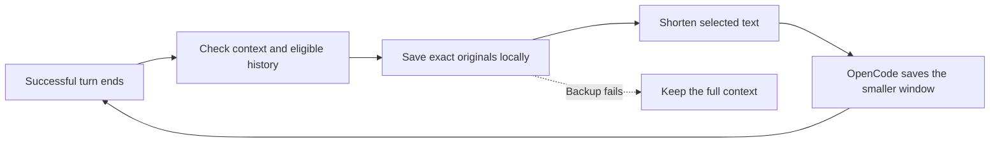

# OpenCode Live Compact

**Keep context under control while the agent works.**

[](https://github.com/anomalyco/opencode/releases/tag/v2.2.6)
[](package.json)
[](package.json)
[](LICENSE)
[](#status)

[Results](#benchmark-results) · [Quick start](#quick-start) · [How it works](#how-it-works) · [Configuration](docs/architecture.md#configuration) · [Run benchmarks](benchmarks/README.md)

Long coding sessions accumulate file reads, command output, and intermediate explanations. **Live Compact** is a native OpenCode plugin that checks after successful turns and shortens eligible completed history locally. It makes no extra model calls for these reductions, preserves the prefix before each cut, and saves the original text for exact recall.

It starts checking at **20,000 tokens** by default, rather than waiting until the context window is almost full. OpenCode's native compaction remains available as a fallback.

## Benchmark results

**150 short programming exercises · Aider Polyglot `7e0611e`**

One continuous session per version, stock OpenCode **2.2.6**, **GPT-6 Luna**, identical ordered exercises, and stock compaction/output defaults. Both versions ran in parallel in Daytona on November 9, 2026.

| Metric | Original OpenCode | Live Compact |
| --- | ---: | ---: |
| Passed | **150/150** | **150/150** |
| Overall cache hit rate | 99.49% | 99.34% |
| Cached input tokens | 296.35M | **266.75M** |
| Non-cached input tokens | 1.519M | 1.759M |
| Estimated API cost | $6.048 | **$5.302 · 12.3% lower** |
| Peak context | 783K | **591K** |
| Compaction | 1 pause · 16.30 s | **93 cuts · 5.93 s** |
| Wall-clock time | 5,106 s | **4,633 s** |

Both passed all 150 exercises on their first graded attempt: **zero failures and zero repair attempts**. Live Compact made 21 span cuts and 72 individual cuts across 81 local replacements, with no native compaction pause.

*Non-cached input includes cache writes. Cache hit rate is cached reads divided by total input. Compaction time includes native and local replacement host wait; local planning outside those events is excluded. The 93 cuts are grouped into 81 host events. Costs are OpenCode usage-based estimates, not billing receipts.*

> This is one paired run, not a guarantee of savings on every workload. It tested the frozen build requiring **1,000 tokens saved per cut**, before the current **1,000-source-token** rule and per-session recovery storage. The table does not measure those later changes. Cache writes increased despite the lower total estimated cost.

[Browse the logs and methodology](benchmarks/results/2026-11-09-aider-150/README.md) · [Raw comparison data](benchmarks/results/2026-11-09-aider-150/comparison.json) · [Per-exercise progress](benchmarks/results/2026-11-09-aider-150/progress.jsonl)

## How it works



1. **Check completed work.** Once context reaches 20,000 tokens, inspect older completed history. Active work and the latest three tool rounds stay intact.
2. **Choose small cuts.** Combine eligible adjacent results into a completed span, or shorten an individual result. The current minimum is 1,000 source tokens; each replacement must reduce both estimated tokens and serialized size.
3. **Back up before changing anything.** Store exact originals in private session directories. If preservation fails, keep the original context.
4. **Save a stable replacement.** Preserve reasoning, tool calls, call/result pairs, message order, and the prefix before the cut. OpenCode persists and reuses the smaller window.
5. **Recall details when needed.** Checkpoints include a reference for `live_compact_recall`. Recall returns exact archived text without a summarization call.

The goal is **lower context growth with useful prompt-cache reuse**. Editing a suffix can still cause cache misses, so fewer prompt tokens alone do not establish lower cost.

### What stays protected

- User requirements, system instructions, active or interrupted work, and recent tool rounds.
- Reasoning, tool-call arguments, identifiers, and valid call/result relationships.
- Unsupported or ambiguous output, diagnostics, existing checkpoints, and their active recovery references.

OpenCode's automatic compaction stays enabled. The plugin can resume after native compaction. Switching provider or model uses OpenCode's fallback to original history.

[Read the architecture, safety rules, and limitations →](docs/architecture.md)

## Quick start

### Use the local checkout

Requires **Node.js 22.18+** and stock **OpenCode 2.2.6**.

```sh
git clone https://github.com/Haoming9527/opencode-live-compact.git
cd opencode-live-compact
npm ci
npm run build
```

In the project where you use OpenCode, add this to `opencode.jsonc`:

```jsonc
{
  "plugins": [
    {
      "package": "/absolute/path/to/opencode-live-compact"
    }
  ]
}
```

Replace the path with your checkout. On Windows, use a path such as `E:/projects/opencode-live-compact`. Start OpenCode in that project and work normally.

### Defaults

| Setting | Default |
| --- | --- |
| Start checking context | 20,000 tokens |
| Minimum eligible source per cut | 1,000 tokens |
| Ordinary span size limit | 32,000 tokens |
| Retained checkpoint text | Up to 8,000 Unicode code points per span |
| Recent tool rounds preserved | 3 |
| Maximum cuts per completed-turn cycle | 3 |
| Recovery budget across sessions | 256 MiB |
| Extra model calls for local reductions | 0 |

Set overrides in the plugin entry's `options` object. [All configuration options →](docs/architecture.md#configuration)

Recovery files live in private per-session directories. Before a backup would exceed the shared budget, cleanup removes the oldest retired backups toward 80% usage. Active checkpoints stay protected; if they leave insufficient room, the plugin keeps the full context.

## Development and benchmarks

```sh
npm run typecheck
npm test
npm run test:integration
```

Integration tests launch stock OpenCode 2.2.6 with a local scripted provider. They verify completed-turn timing, prefix preservation, exact recall, restart, backup failure, and continued operation after native compaction without paid model calls.

The benchmark runner supports four suites:

| Suite | Workload |
| --- | --- |
| Short | 6 small JavaScript tasks |
| SemVer | 10 sequential feature-development stages |
| Aider Polyglot | 150 programming exercises across five languages |
| Web-Bench React | 20 dependent tasks building one application |

[Run any of the four locally or in Daytona →](benchmarks/README.md)

## Status

**Experimental; npm publication is planned after further validation.** The local checkout is the installation method available here. The intended future command is:

```sh
opencode plugin add opencode-live-compact
```

The completed Aider comparison is included above. The separate Web-Bench comparison is not included in those results. Further repeated runs are needed to assess long-task reliability and how consistently cost and pause reductions hold.

Bug reports and reproducible examples are welcome. Include your OpenCode version, provider/model, plugin options, and relevant diagnostics with private content removed.

## Inspiration and license

Inspired by the high-level ideas behind [DSH Live Compact](https://github.com/Tranquillitatis-Lab/dsh-live-compact): incremental local reductions, preserving the prefix before a cut, and recoverable originals. This TypeScript implementation was independently designed for OpenCode; it does not copy or port DSH's implementation.

[MIT licensed](LICENSE).
